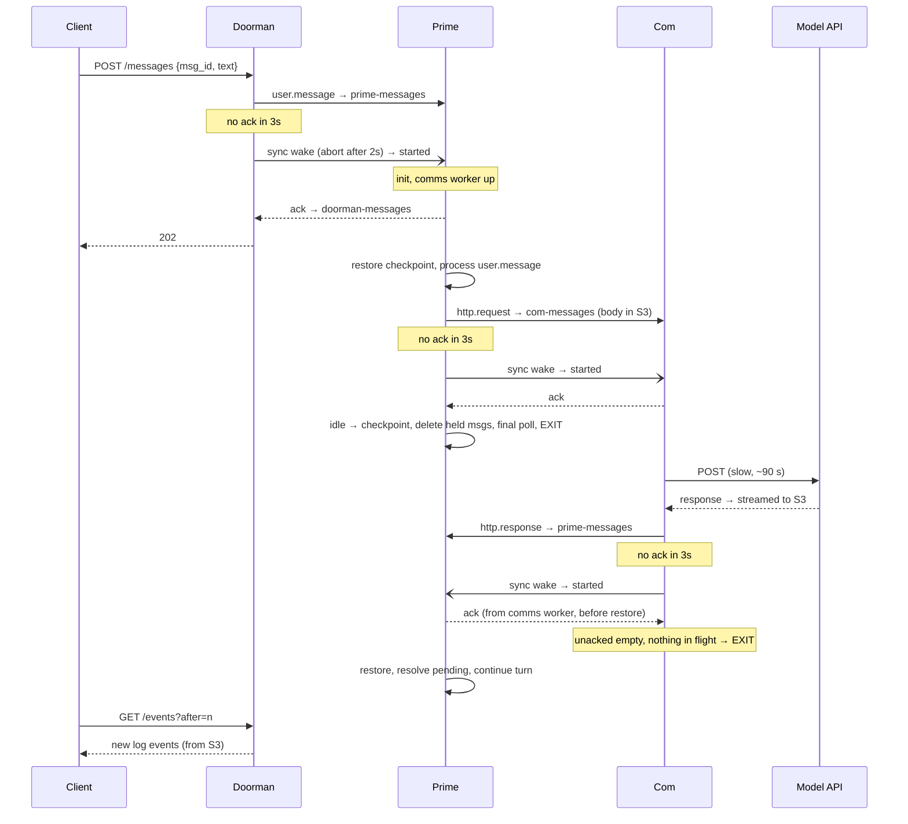

# stz-agent: Handoff Protocol (draft v2)

> Companion to [spec.md](spec.md). Values marked **[TBD]** are starting points to tune.

## 1. Problem and principle

Prime and Com each exit when idle, and Prime exits **while its HTTP requests are still in flight**. That is the point of the system. A sender must therefore never leave a message in a queue that no live process will read. The hard case is a race: the recipient decides to exit just as a message arrives.

**Principle: per-message positive handoff.** A sender stays responsible for *each* message until the recipient acks *that* message. Senders don't track whether the recipient is awake. A missing ack is the only signal, and the response to it is always the same: wake the recipient and keep waiting.

## 2. Channels

| Lambda | Message queue | Woken by |
|---|---|---|
| Doorman | `doorman-messages` (acks only) | API Gateway (sync) |
| Prime | `prime-messages` | sync wake from Doorman or Com; async self-wake |
| Com | `com-messages` | sync wake from Prime |

- There is **one message queue per Lambda** and **no wake queues**. Message queues have no Lambda trigger. The running instance polls its own queue.
- All three Lambdas have **reserved concurrency 1**.
- Queues are **standard** SQS. Delivery is at-least-once, so every handler dedupes by `msg_id`.
- Use long polling, with `WaitTimeSeconds` 1–5 s.

| Queue | Visibility timeout | Why |
|---|---|---|
| `prime-messages` | 15 min | Prime holds received messages until its next checkpoint (§6) |
| `com-messages` | 30 s | Com deletes requests on accept |
| `doorman-messages` | 30 s, retention 60 s (the minimum) | Acks are only useful for one request's lifetime |

`prime-messages` and `com-messages` each have a DLQ with `maxReceiveCount` 5.

## 3. Envelope

Every SQS message body has this shape:

```json
{
  "v": 1,
  "msg_id": "uuid",                // unique per logical message. For user.message, generated by the CLIENT
  "type": "user.message | http.request | http.response | ack",
  "from": "doorman | prime | com",
  "to": "doorman | prime | com",
  "corr_id": "…",                  // request_id for http.*; acked msg_id for ack
  "sent_at": "ISO-8601",
  "body": { }
}
```

- `user.message`: `{text}`
- `http.request`: `{request_id, method, url, headers, body_ref?, auth: "none"|"anthropic"|"openai"|"bedrock"|"mock", timeout_s, purpose: "model"|"repl"}`
- `http.response`: `{request_id, ok, status?, headers?, body_ref?, bytes?, elapsed_ms, error?}`
- `ack`: `{acked_msg_id}`

Bodies always go in S3. SQS messages carry IDs and S3 keys only.

## 4. Waking a Lambda

### 4.1 Sync wake (Doorman → Prime, Prime → Com, Com → Prime)

A sync wake is a `lambda:Invoke` call with `InvocationType: "RequestResponse"` and payload `{reason: "wake"}`. Doorman's `POST /wake` sends `{reason: "prewake"}` instead, with no message and no ack loop. Its only purpose is to pay Prime's Lambda cold start before the user's first message (spec §7). How it behaves:

- **The Invoke call is an HTTPS request to the Lambda service.** Lambda checks concurrency *before* running anything. If the target is already at its limit of 1, Lambda rejects the call immediately with a **429**. Nothing is queued and nothing is retried. A wake to a running instance therefore can't pile up or fire later.
- **Otherwise, Lambda runs the target**: a cold init if needed, then the handler. Lambda **sends the response only when the handler returns**. Prime's handler is its whole run (restore, drain messages, agent loop, checkpoint), so that can be minutes. Startup (loading the harness and compiling the WASM) is only the first part of it.
- **We don't wait for that.** The caller sets its own client-side timeout of `WAKE_CALL_TIMEOUT` (2 s **[TBD]**) on the call: an `abortSignal` on the SDK v3 `send()`, with `maxAttempts: 1` so the SDK doesn't retry 429s on its own. When the timeout fires, our side closes the connection. **This is something we implement, not something Lambda does.** Lambda doesn't cancel an invocation when the caller disconnects, so the target keeps running. *Verified in spike S2 (#0022, 2026-11-21): after a 2 s abort, the 10 s target wrote its marker 10.0 s after the call started; an immediate second sync call got `TooManyRequestsException` / `ReservedFunctionConcurrentInvocationLimitExceeded` (HTTP 429), classified `running`; an async self-invoke sent as the last action started 0.3–0.7 s after the parent finished. Stub (128 MB) round trip: cold ~1.7 s, warm ~0.09 s.*

**The Invoke result is for logging only. It never confirms anything.**

| Result within `WAKE_CALL_TIMEOUT` | Meaning | Logged as |
|---|---|---|
| 429 with reason `ReservedFunctionConcurrentInvocationLimitExceeded` | An instance is running. It might be about to exit. | `wake: running` |
| Our timeout fires | Lambda accepted the call. It's probably starting or running. | `wake: started` |
| Fast error (e.g., `FunctionError`, init crash) | The target failed to start | `wake: failed` + error |
| Other error (IAM, network) | Misconfiguration or transient | `wake: error` + error |

What happens if startup fails after our timeout has fired? We can't tell from the Invoke result. **The only thing we trust is the ack.** That's why the wake runs inside the ack loop (§5): if no ack arrives, we wake again.

### 4.2 Async self-wake (Prime → Prime)

Prime can't sync-wake itself, because its own running instance makes the call return 429. To continue past its run deadline (§8), Prime sends an async invoke (`InvocationType: "Event"`, `{reason: "continue"}`) as **the last thing before it returns**.

- Lambda holds a throttled async event and retries it internally, so the event runs as soon as this instance has exited.
- Set the function's event-invoke config to `MaximumEventAgeInSeconds = 60` and `MaximumRetryAttempts = 0`, so a self-wake that can't land within 60 s expires instead of lingering.

This is the only place we use async invoke.

## 5. Sender: the delivery monitor

Each sender keeps an **unacked set** per recipient: `msg_id → {sent_at, last_wake_at}`.

```
send(msg):
  enqueue msg → recipient's message queue
  unacked[recipient][msg.msg_id] = {sent_at: now, last_wake_at: null}

on ack(acked_msg_id) from recipient:
  delete unacked[recipient][acked_msg_id]

monitor tick (every 500 ms), per recipient with a non-empty unacked set:
  oldest = earliest unacked entry
  waited = now - (last wake to this recipient, or oldest.sent_at if no wake yet)
  limit  = ACK_TIMEOUT if no wake sent yet for these msgs, else WAKE_ACK_TIMEOUT[recipient]
  if waited > limit:
    sync_wake(recipient)                     # §4.1; log the result
    record last_wake_at = now for this recipient
```

- **One wake covers every pending message to that recipient.** A woken recipient drains its whole queue.
- **The original message is never re-sent.** It stays in the queue, and only the wake repeats.
- Prime and Com **loop forever**, logging each wake. Even if the target keeps failing to start, this costs one small API call every `WAKE_ACK_TIMEOUT`, and the logs make the failure obvious. **[TBD: add a cap?]**
- Doorman is bounded by API Gateway's ~30 s limit (§7.1).

| Param | Start | Notes |
|---|---|---|
| `ACK_TIMEOUT` | 3 s | First wait, before any wake. Must exceed the recipient's poll interval. |
| `WAKE_ACK_TIMEOUT` (Prime) | 15 s **[TBD: measure on Prime]** (S2 stub: cold invoke ~1.7 s) | Sized for a *cold* start (init + WASM compile + comms worker start). A warm start acks much sooner. It doesn't include the state restore, because Prime acks before it restores (§6). |
| `WAKE_ACK_TIMEOUT` (Com) | 5 s **[TBD: measure]** | Small Node function |
| `WAKE_CALL_TIMEOUT` | 2 s | Client-side abort on the Invoke call |

## 6. Recipient: the comms worker

Prime and Com run all SQS work in a **comms worker** (`worker_threads`), separate from their main thread. On Prime, the main thread can be blocked by a synchronous QuickJS eval or by snapshotting, and acks have to keep flowing anyway. Com uses the same module so there's only one implementation.

The comms worker owns:
- polling its own message queue;
- sending acks;
- the outbound unacked sets and the delivery monitor (§5);
- enqueueing outbound messages. The main thread `postMessage`s them to the worker.

On receiving a message, the worker does this:

1. **`ack`**: update the unacked set, then delete the message.
2. **Any other type**: send `ack` to the sender's message queue *right away*, then hand the message and its receipt handle to the main thread. An ack means "I'm awake and I have it".
   - **Durability** comes from SQS itself. The message stays in the queue, invisible, until the recipient deletes it. If the recipient dies first, the message reappears after the visibility timeout.

What the main thread does with it:

| | Dedupe | When to delete the SQS message |
|---|---|---|
| **Prime** | `msg_id` in the checkpointed seen set → delete it, skip it | **After the next durable checkpoint** that includes the message's effects (spec §5.4). If Prime crashes before that, the message reappears and the work is redone from the last checkpoint. |
| **Com** | `request_id` in flight or recently done → delete it, skip it | **On accept**, right away. If Com dies, its requests die with it. That's by design. |
| **Doorman** | n/a | Doorman only receives acks. It deletes every message it reads, including stale acks from earlier requests. |

On Lambda, the comms worker starts **first**, before Prime restores its state, so acks go out as soon as init is done. Messages that arrive during restore queue up for the main thread. Before the handler returns, the worker is terminated.

## 7. Per-Lambda rules

### 7.1 Doorman (request-scoped)

1. The client sends `POST /messages {msg_id, text}`. **The client generates `msg_id`.**
2. Doorman enqueues `user.message` to `prime-messages`.
3. Doorman runs the delivery monitor for up to ~20 s, watching `doorman-messages` for the ack.
4. If the ack arrives, Doorman returns `202 {msg_id}`. If not, it returns `503`. **The client retries with the same `msg_id`**, and Prime dedupes. The client is the last link in the chain of responsibility.

### 7.2 Com exit

Com may exit when:
1. no requests are in flight;
2. its unacked set is empty: every `http.response` has been acked by Prime;
3. a final poll of its message queue comes back empty.

### 7.3 Prime exit

Pending Com requests **do not** block exit. Waiting on them is the reason to exit. The full checklist is in spec §5.5. In short:
1. the harness is idle;
2. the REPL is quiescent;
3. the unacked set is empty (Com has every request);
4. the checkpoint is durable;
5. held messages are deleted;
6. a final poll of the message queue comes back empty.

## 8. Deadlines

Lambda's hard limit is 15 min, and both Prime and Com set their timeout to it.

- **Prime**: at **12 min** of run time, it stops starting new work, reaches quiescence, checkpoints, sends the async self-wake (§4.2), and returns.
- **Com**: it accepts (acks) a request only if `now + timeout_s < run_start + 15 min − margin`. Otherwise it leaves the request **unacked** in its queue.
  - Prime's monitor then keeps waking Com. Those wakes get 429s until this Com exits, and the next Com picks the request up.
  - Prime can't exit while that request is unacked, so the request can't be stranded.
  - Com needs no self-wake.

## 9. Walkthroughs

**A. Com believes Prime is awake, but Prime has gone to sleep.**
1. Prime sent several requests. Some came back while Prime was up.
2. Prime checkpointed and exited, and one long request is still running.
3. The long response arrives, and Com enqueues `http.response`. Com doesn't know or care whether Prime is up.
4. No ack within 3 s, so Com sends a sync wake → `started`.
5. Prime inits, its comms worker drains the queue and acks, and only then does Prime restore.
6. Com's unacked set is now empty, so Com exits.

**B. Recipient exiting as a message lands.**
1. Prime's final poll was empty, and it's mid-return.
2. Com's message arrives. No ack, so Com wakes Prime → `429` (the instance is still returning).
3. After `WAKE_ACK_TIMEOUT`, Com wakes again → `started`.
4. The new Prime drains the queue and acks.

The race costs one `WAKE_ACK_TIMEOUT` of latency. No message is lost.

**C. Busy recipient.**
1. Prime's main thread is in a 20 s eval, but its comms worker acks immediately.
2. Even if an ack were late, the resulting wake would get a 429 and leave no trace.

**D. Prime fails to start** (for example, a bad deploy).
1. The wake returns `failed`, or it returns `started` and init crashes later.
2. No ack arrives, so the sender wakes again every `WAKE_ACK_TIMEOUT` and logs each attempt.
3. The messages wait in `prime-messages` until a fix is deployed (or they reach the DLQ).

**E. Prime crashes mid-run.**
1. Messages it received since the last checkpoint were never deleted, so they reappear after the 15-min visibility timeout.
2. Nothing wakes Prime automatically. The next user message, or Com response, does.
3. The new Prime restores the last checkpoint and redoes the work. Side effects of the lost run may repeat, and responses to request IDs it doesn't know are dropped.

This is acceptable for a PoC.

## 10. Sequence: one turn with a slow model call


