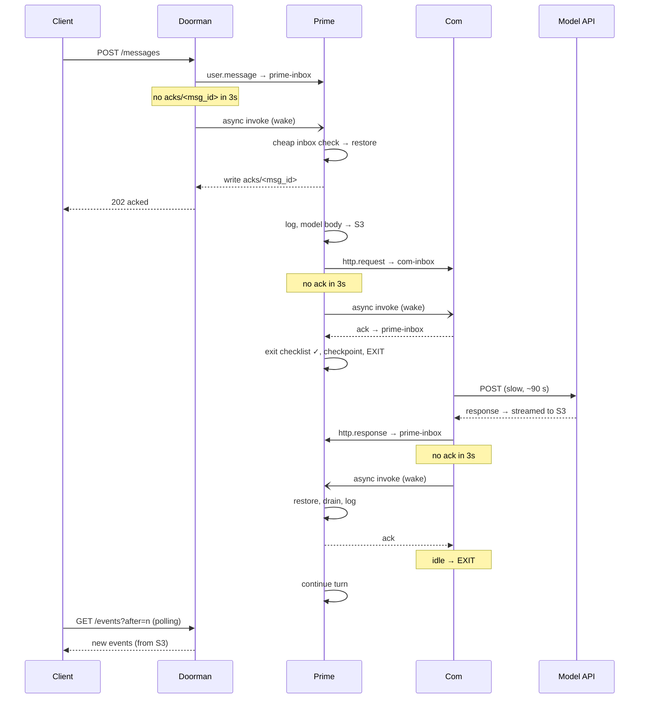

# stz-agent: Handoff Protocol (draft v1)

> Companion to [spec.md](spec.md). Values marked **[TBD]** are starting points to tune.

## 1. Problem

Prime and Com each exit when idle. A sender must never leave a message in a queue that no live process will read. The hard case is a race: the recipient decides to exit at the same moment the sender enqueues a message.

A one-time "are you awake?" ping/pong doesn't fix this, because the recipient can answer the ping and then exit. Instead we use a **per-message positive handoff**: the sender stays responsible for *each* message until the recipient acks *that* message.

The second problem is **stale wakes**. A wake that fires right after the recipient decided to sleep restarts it for nothing. We want wakes to be rare, short-lived, and cheap when they misfire.

## 2. Wake mechanism: async invoke, not an SQS trigger

**Decision (v0): a wake is an async Lambda invoke** (`InvocationType: "Event"`) of the target function, with a small payload `{reason, for_msg_id?}`.

Why not a wake queue with an event source mapping (ESM)?

- With reserved concurrency 1, a wake sent while the target is running gets **throttled** and returned to the queue. It comes back only after the queue's **visibility timeout**, which Lambda requires to be **≥ the function timeout**, so up to about 15 min later. The result is a stale wake long after the target went to sleep, or a real wake delayed by minutes.
- A running instance can't reliably clear accumulated wakes, because the ESM's pollers are constantly receiving from that queue. (This was your concern.)
- An ESM also can't be held to one concurrent invocation: its `MaximumConcurrency` minimum is 2.

Async invoke behaviour with reserved concurrency 1:

- If the target is running, the invoke is throttled, and **Lambda retries it internally** with backoff (about 1 s, growing to at most 5 min).
- We set **`MaximumEventAgeInSeconds = 60`** **[TBD]** (the minimum allowed) on the function's event-invoke config, so a wake that can't land within 60 s is **discarded**. Wakes can't pile up.
- We set **`MaximumRetryAttempts = 0`**. That covers function *errors*, not throttles: a wake handler that crashed shouldn't be replayed.
- Wakes carry no data the target depends on. On startup the target always drains its inbox, and the inbox is the source of truth.

Stale wakes can still happen. A wake sent to a busy instance retries until that instance exits, then lands on an empty inbox. Two defences:

1. Senders wake **only when an ack doesn't arrive** (§5), so wakes are rare while the target is awake and responsive.
2. The wake handler's first step is a cheap inbox check (spec §5.1). If the inbox is empty, it returns in about 1 s without loading the REPL.

**[TBD — verify in the infra hour]:** throttled-retry timing in practice, and that a 60 s max event age is enough for a sender's wake to land after a slow Prime exit (checkpoint time).

## 3. Queues and envelope

| Queue | Consumer | Carries |
|---|---|---|
| `prime-inbox` | running Prime (background long-poll) | `user.message`, `http.response`, `ack` |
| `com-inbox` | running Com (long-poll) | `http.request`, `ack` |

- **Standard** queues, with no Lambda trigger. Delivery is at-least-once and unordered, so every handler is idempotent by `msg_id`.
- Long polling: `WaitTimeSeconds` 1–5 s inside work loops, up to 20 s when only waiting.
- Visibility timeout 30 s **[TBD]**. A message received but not deleted, for example because the receiver crashed, reappears after this long.
- DLQ with `maxReceiveCount` 5.
- Doorman doesn't have an inbox. Its acks come back through S3 markers (§5).

Envelope (the SQS message body):

```json
{
  "v": 1,
  "msg_id": "uuid",                 // unique per logical message
  "type": "user.message | http.request | http.response | ack",
  "from": "doorman | prime | com",
  "to": "prime | com",
  "corr_id": "…",                   // request_id for http.*; acked msg_id for ack
  "sent_at": "ISO-8601",
  "body": { }
}
```

- `user.message`: `{text}`
- `http.request`: `{request_id, method, url, headers, body_ref?, auth: "none"|"anthropic"|"openai"|"bedrock"|"mock", timeout_s, purpose: "model"|"repl"}`
- `http.response`: `{request_id, ok, status?, headers?, body_ref?, bytes?, elapsed_ms, error?}`
- `ack`: `{acked_msg_id}`

## 4. Recipient rules

For each message received from your inbox:

1. **Dedupe.** If `msg_id` was already handled (Prime: present in the log; Com: in its in-flight table or recent-done set), go to step 3.
2. **Take ownership.** Prime appends the message to the log. Com registers the request and starts it.
3. **Ack.** To Prime or Com: send `ack` to the sender's inbox. To Doorman: write the S3 marker `acks/<msg_id>`.
4. **Delete** the SQS message.

Order matters: **persist → ack → delete**. A crash at any point leads to redelivery, then dedupe, then a re-ack.

`ack` messages don't get acked themselves; the recipient just deletes them.

Prime runs its inbox poller as a **background task**, so it acks while the agent loop is busy. A long, synchronous REPL eval can delay acks. That causes a spurious wake (bounded and cheap, §2), not a lost message.

## 5. Sender rules (the handoff)

```
send(msg):
  enqueue msg → recipient.inbox
  if await_ack(msg.msg_id, ACK_TIMEOUT): return OK            # recipient was awake
  for attempt in 1..WAKE_RETRIES:
    async-invoke recipient {reason:"msg", for_msg_id}
    if await_ack(msg.msg_id, WAKE_TIMEOUT): return OK         # it woke and took it
  return FAILED     # log error; msg is still in the inbox (eventually the DLQ)
```

| Param | Start | Notes |
|---|---|---|
| `ACK_TIMEOUT` | 3 s | > the recipient's poll interval + persist time |
| `WAKE_TIMEOUT` | Com 10 s, Prime 30 s | Prime: cold start + REPL restore |
| `WAKE_RETRIES` | 3 | `WAKE_TIMEOUT` < 60 s max event age, so each wake has expired before the next one is sent |

- `await_ack`: Prime and Com watch their own inbox for `ack{acked_msg_id}`. Doorman polls `HEAD acks/<msg_id>` every 250 ms.
- **The original message is never re-sent.** It stays in the inbox, and the woken recipient drains it. Only the wake is retried.
- **A sender may not exit while any of its sends is unacked.** This is why Com stays up after a response finishes until Prime acks it.

## 6. Exit rules

**Prime** follows the exit checklist in spec §5.5: agent idle, REPL quiescent, all outbound acked, all inbound handled, checkpoint durable, final poll empty.

**Com** may exit when nothing is in flight, every `http.response` it sent has been acked, and a final inbox poll (`IDLE_GRACE` 2 s) is empty.

**Doorman** is request-scoped. It returns once the handoff finishes, or after about 20 s with `waking`.

### Race walkthrough: recipient exits as a message arrives

1. Prime's final poll is empty, and it starts returning.
2. Com enqueues `http.response` → `prime-inbox`.
3. No ack within 3 s, so Com async-invokes Prime.
4. If the old instance is still returning, the invoke is throttled and Lambda retries it within seconds.
5. A new Prime starts, finds the message, logs it, and acks it.
6. Com gets the ack and exits.

No message is lost; the race only costs latency.

### Race walkthrough: busy recipient, spurious wake

1. Prime is in a 10 s eval, so its ack to Com is late. Com sends a wake, which is throttled.
2. Prime acks, finishes the turn, and exits.
3. The retried wake lands within the 60 s max event age. The new Prime sees an empty inbox, logs `stale_wake`, and returns in about 1 s.

The cost is one short invocation.

## 7. Failure handling

| Failure | Response |
|---|---|
| Com dies with requests in flight | **The requests die with it.** No watchdog and no retry. Prime finds out on its next wake (in practice the next user message): any pending request older than `timeout_s` + 60 s is failed (`error:"lost"`). Its `__pending` promise is rejected, or a model call is reported as failed, and the turn carries on. |
| Prime dies mid-turn | The next wake replays the log and restores the last snapshot (spec §5.4). Interrupted evals are reported to the model and not re-run. |
| Wake retries exhausted | `send()` returns FAILED and logs an error. Doorman returns `503`. The message stays in the inbox (and eventually the DLQ). |
| Poison message | Goes to the DLQ for manual inspection. |

## 8. Sequence: one turn with a slow model call


