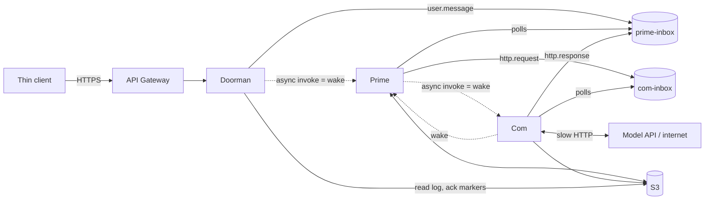

# stz-agent: Spec (draft v1)

> Status: **draft** for a ~4-hour, two-person hackathon PoC. Items marked **[TBD]** are open; see [open-questions.md](open-questions.md). The wire protocol is in [protocol.md](protocol.md).

## 1. Goal

Show that an AI agent harness can **scale to zero while it waits**. When the agent is blocked on a slow call (model inference, a slow fetch from a REPL script), the expensive harness process exits and stops billing. A cheap process holds the open connection and wakes the harness when the result lands.

This is a demo of the architecture, not of agent features. When a choice comes up, pick whatever keeps the scale-to-zero path simple and visible.

### Success criteria (the demo)

1. A user sends a message from a thin client. The agent makes a slow model call (≥ 60 s, using the mock slow model, §8). Prime **exits during the wait**, is **woken** when the response lands, and the turn completes correctly.
2. A REPL script that `await`s a slow `fetch` survives a Prime exit and restart **mid-await**. A function the model defined earlier is still callable after the restart.
3. A cost readout from CloudWatch `REPORT` lines shows Prime's billed GB-seconds against wall-clock time. Idle time should be billed to Com (128 MB), not Prime (2 GB).

### Non-goals

- **Browser**: tabled for the hackathon.
- Multiple concurrent sessions, multi-tenancy, real auth.
- Streaming tokens to the client. Responses land in S3 whole before Prime sees them.
- A tool catalog. The model gets one tool, the REPL, and writes scripts for everything else.

## 2. Components

All function code is **TypeScript (Node.js)**. Infra stays in Python CDK.

| Name | Memory | Concurrency | Job |
|---|---|---|---|
| **Doorman** | 128 MB | unreserved (cap ~5) | API Gateway handler. Hands user messages to Prime, waking it if needed. Serves the log to the client. |
| **Prime** | 2 GB | reserved = 1 | Agent harness: agent loop, append-only log, QuickJS-in-WASM REPL, network proxy. Exits whenever it's idle. |
| **Com** | 128 MB | reserved = 1 | Outbound HTTP for Prime. Holds connections open, streams response bodies to S3, notifies Prime. |

Prime gets 2 GB as headroom (WASM snapshots, large model contexts). That's more than it needs without the browser, and it also makes the cost contrast with Com obvious.

Supporting resources (one set per stack/env):

- **S3 bucket**: log, request/response bodies, REPL snapshots, workspace files, ack markers.
- **SQS**: `prime-inbox`, `com-inbox`, plus DLQs. Inboxes have **no Lambda trigger**; the running instance polls them.
- **Wake** = async Lambda invoke, not an SQS trigger. See [protocol.md](protocol.md) §2 for why.
- **API Gateway** (HTTP API) → Doorman.
- **Secrets Manager**: model API keys (Anthropic, OpenAI-compatible), readable **only by Com**.



## 3. Core rules

These are the invariants. Code that breaks one of them is a bug.

1. **Prime makes no outbound network calls of its own** except to AWS (S3, SQS, Lambda). Model calls and REPL fetches all go through Com.
2. **The log is the source of truth.** Prime's harness state is rebuilt from the log plus the latest REPL snapshot (§5.4).
3. **Positive handoff.** A sender stays responsible for a message until the recipient acks it. A recipient acks only after it has durably taken ownership ([protocol.md](protocol.md)).
4. **Bodies go through S3, never through SQS.** Messages carry IDs and S3 keys only.
5. **One live Prime and one live Com** (reserved concurrency 1). Single-writer assumptions rely on this.
6. **Prime exits only when the exit checklist (§5.5) passes.**

## 4. Session model and storage

There is **one agent per stack** with **one log**. `/clear` starts a new *conversation*: the model context resets, but the **REPL state and workspace carry over**, because the scripts the model has built up are the valuable part. A clear is just an event in the log.

```
s3://<bucket>/
  log/<seq:010d>.json         # append-only, one object per event
  bodies/<request_id>.req     # HTTP request body (written by Prime)
  bodies/<request_id>.res     # HTTP response body (written by Com)
  repl/snap-<seq>.bin         # REPL snapshot taken at log seq
  repl/latest.json            # {"seq": N, "key": "repl/snap-N.bin"}; written AFTER the snapshot
  workspace/...               # REPL file system, mirrored from /tmp/workspace
  acks/<msg_id>               # empty marker: Prime has taken a Doorman message
```

### 4.1 Log

- Prime is the **only writer**. Each event is written with S3 `If-None-Match: *`, so an existing seq is never overwritten. A conflict means the single-writer rule was broken: fail loudly.
- Event shape:

```json
{
  "seq": 42,
  "ts": "2026-11-19T20:01:02.345Z",
  "conv": 3,                 // conversation number; increments on /clear
  "kind": "user.message | conv.clear | model.request | model.response | tool.call | tool.result | http.request | http.response | lifecycle | error",
  "corr_id": "…",            // request_id / tool_call_id, links pairs
  "msg_id": "…",             // inbound SQS msg_id, for dedupe
  "body": { },               // small inline payload
  "body_ref": "bodies/…"     // or a pointer to a large payload
}
```

- The model context is every relevant event since the last `conv.clear`.
- `lifecycle` events (`start`, `restore`, `stale_wake`, `checkpoint`, `exit_idle`, `exit_deadline`) drive the demo narrative and the cost report.

## 5. Prime

### 5.1 Handler flow

1. **Start.** Do cheap work first. Long-poll `prime-inbox` once for about 1 s. If it's empty and the invocation isn't a self-continuation (`reason:"continue"`, §5.5), log `stale_wake` and return **without loading the REPL**. Keep module init light by lazy-loading the WASM. Since Aug 2025 Lambda bills INIT time, so spurious wakes should cost little.
2. **Restore.** Read the log, rebuild harness state, restore the REPL (§5.4), and sync the workspace to `/tmp/workspace`. Start a background inbox poller.
3. **Drain and run.** Process inbox messages ([protocol.md](protocol.md) §4) and run the agent loop while there is runnable work:
   - A `user.message`, or a `model.response` with tool calls, is runnable. A REPL eval that settled after a response came in is also runnable.
   - Model call: write the body to S3, log `model.request`, hand off `http.request` to Com, and **don't wait**.
   - `repl` tool call: see §5.2.
   - `/clear`: log `conv.clear`.
4. **Exit** once the checklist (§5.5) passes.

### 5.2 REPL (QuickJS in WASM)

- **One tool**: `repl(code) → {value, stdout, stderr, error}`. The model writes scripts for file I/O, HTTP, and parsing.
- **Runtime**: QuickJS compiled to WASM. REPL state lives in WASM linear memory, and a snapshot of that memory (plus mutable globals and table) is the REPL's persisted state. **[RISK #1: spike first; see open-questions.]**
- **Never use an Asyncify build.** All host↔REPL async goes through JS promises, so the WASM call stack is always empty between host calls. That's what makes snapshots consistent.
- **No callbacks into the host across a snapshot.** Any state the host needs to find again lives in JS globals inside the snapshot:
  - `globalThis.__pending[request_id]` holds `{resolve, reject}` for in-flight fetches.
  - `globalThis.__evals[tool_call_id]` holds `{status, value, error}` for evals that haven't settled.
  - The host *reads* these after running pending jobs. It never holds QuickJS handles across a checkpoint.
- **Host functions** (`__host_fetch`, `__host_log`, and the fs bindings) must be registered **in the same order on every boot**, so any references inside the snapshot stay valid. **[RISK: verify in spike.]**
- **Eval**: each eval is wrapped as `__evals[id] = {status:"pending"}; (async () => { <code> })().then(...)`, which writes its result into `__evals[id]`. The host then runs pending jobs to quiescence.
  - If the eval settles, snapshot the REPL, then log `tool.result`.
  - If it is still pending, it can only be waiting on `__pending` fetches (§5.5 ensures that). The tool call stays open and the model turn waits. **This is the scale-to-zero case.**
- **Eval CPU time limit** is 30 s **[TBD]**, enforced with the QuickJS interrupt handler.
- **Timers**: `setTimeout`/`setInterval` are **not provided** in v0, because a pending timer would block exit.
- **File I/O**: `/workspace` maps to `/tmp/workspace`, which is synced to S3 `workspace/` at checkpoint.

### 5.3 Network proxy

- The REPL has no sockets. `fetch(url, opts)` inside the REPL calls `__host_fetch`, which is Prime's proxy handler:
  1. It assigns a `request_id`, stores the resolver in `__pending`, writes the request body to S3, logs `http.request`, and hands the request off to Com over SQS ([protocol.md](protocol.md)).
  2. It returns immediately. The REPL sees a pending promise.
  3. When `http.response` arrives, possibly in a later Prime invocation, the proxy reads the body from S3, calls `__pending[id].resolve(...)` inside the REPL, and runs pending jobs.
- The model adapter uses the same proxy path, so Com has a single code path.
- Each request names an `auth` mode for Com: `none` (always used for REPL fetches), `anthropic`, `openai`, `bedrock`, or `mock`.
- **Model adapters** in Prime translate the harness's internal turn format to and from each provider's wire format: Anthropic Messages API, the **OpenAI Chat Completions spec** (any OpenAI-compatible endpoint, configured by base URL + model name, e.g. OpenAI, vLLM, Ollama, OpenRouter), and Bedrock. Pick the provider by config (env var), not per turn. The mock model speaks the Anthropic format; if time allows, add an OpenAI-shaped mock too.

### 5.4 Restore and snapshot consistency

- A snapshot taken at log seq N captures the REPL after every event ≤ N.
- Restore = load the snapshot, then **replay REPL-affecting events with seq > N**. The only replayable kind is an `http.response` for a REPL fetch, which is just a `resolve` call.
- `repl` evals are **never re-run on replay**. If the log has a `tool.call` with no `tool.result` and no matching pending eval in the snapshot, Prime crashed mid-eval. Log `tool.result{error: "interrupted; may have partially executed"}` and let the model decide what to do.
- When to snapshot: after every eval settles (before logging `tool.result`), and at checkpoint.
- If a response arrives for a `request_id` that isn't in `__pending`, log it and drop it.

### 5.5 When Prime may exit (exit checklist)

Prime returns from its handler only when **all** of these hold, checked in this order:

1. **Agent loop idle.** No unprocessed `model.response`, and no `user.message` waiting for a model call. Pending Com requests are fine: waiting on them is the reason to exit.
2. **REPL quiescent.** No eval is executing, the QuickJS job queue has been drained to empty, and every pending eval is waiting only on `__pending` fetches. No timers exist (§5.2).
3. **Outbound handoffs complete.** Com has acked every `http.request`. Without the ack, Com may never see the request.
4. **Inbound complete.** Every received message has been logged, acked, and deleted.
5. **Checkpoint durable.** The snapshot object has been written, *then* `repl/latest.json` has been updated, and the workspace has been synced. Updating the pointer last makes the switch atomic.
6. **Final poll empty.** A final inbox long-poll of `IDLE_GRACE` (2 s **[TBD]**) *after* the checkpoint returns nothing. If a message arrives, process it and go back to step 1.

**Deadline.** If Prime is within 60 s **[TBD]** of its 15-min timeout and still has runnable work, it reaches quiescence (the eval limit bounds this), checkpoints, sends a **self-wake** (async invoke with `{reason:"continue"}`), and returns. Concurrency 1 means the self-wake can only run after this instance is gone. The throttled invoke is retried (protocol §2).

**No linger.** Prime can't know how long a wait will be, so v0 always exits as soon as the checklist passes. The only delay is `IDLE_GRACE`. A fuller build could learn expected durations from the logged request timings (by host or model) and stay up for short ones. That's out of scope here.

## 6. Com

- One instance with many concurrent requests (Node async I/O).
- On `http.request`: read the body from S3, register the request as in-flight, ack Prime, delete the message, then start the request.
- Auth: `anthropic` attaches `x-api-key` from Secrets Manager. `openai` attaches `Authorization: Bearer <key>` from Secrets Manager (one key per configured OpenAI-compatible base URL). `bedrock` signs with SigV4 using Com's role. `mock` uses the mock model (§8). `none` sends the request unchanged.
- Com is provider-agnostic apart from auth: it doesn't parse model responses, it just stores bytes.
- Stream the response body to `bodies/<request_id>.res` (S3 multipart or `lib-storage` `Upload`). Never buffer the whole body in memory.
- When the request finishes or fails, hand off `http.response` to Prime (ack, or else wake). **Always send a terminal response**: success, HTTP error, or timeout. This guarantees Prime is woken eventually.
- Per-request timeout of 10 min **[TBD]** keeps every request under Com's own 15-min limit. Near its deadline, Com stops taking new requests (leaving them in the inbox), finishes or fails the in-flight ones, self-wakes, and exits.
- **Exit** when nothing is in flight, every delivery is acked, and a final inbox poll is empty.

## 7. Doorman and API

| Method | Path | Behaviour |
|---|---|---|
| `POST` | `/messages` | Body `{text}`. Text `/clear` is a clear. Sends `user.message` to `prime-inbox`, then waits for the ack (protocol §5) and wakes Prime if needed. Returns `202 {msg_id, prime: "acked"\|"waking"}`. |
| `GET` | `/events?after=<seq>` | Lists and reads `log/` objects after `seq`. **Never wakes Prime.** The client polls this every 1–2 s. |

- Doorman learns about the ack through an **S3 marker** (`acks/<msg_id>`), not a queue. Because nothing is shared, Doorman needs no singleton constraint and no inbox.
- API Gateway times out at about 30 s, so Doorman waits at most about 20 s for the ack, then returns `202 waking`. The message is safe in the inbox either way.
- Auth: a static bearer token in an environment variable.
- Client: a small TS CLI REPL (`client/`) that posts lines and polls events.

## 8. Demo and test tooling

- **Mock model** (`auth: "mock"`): Com sleeps N seconds and returns a canned Messages-API-shaped response. It is configurable with a script of responses: say a tool call that runs a `fetch` first, then a final answer. This gives deterministic, cost-free runs of the full loop.
- **Slow URL for REPL fetches**: `mock://slow?seconds=90&body=...` is handled by Com in the same way.
- **Cost report**: `scripts/cost-report.ts` pulls `REPORT` lines for all three functions over a time window and compares billed GB-s with "Prime stays up for the whole wall-clock time".
- **Tests**: CDK assertions (queues, reserved concurrency, Com-only secret access, async-invoke config). Unit tests run the handoff logic against an in-memory queue fake.

## 9. Repo layout

```
app.py, stz_agent/           # CDK (Python). Functions built with esbuild → lambda.Code.from_asset
                             #   (or aws_lambda_nodejs.NodejsFunction)
functions/                   # one TS package (npm workspace)
  shared/protocol.ts         # envelope types, send-with-handoff, inbox poller
  doorman/  prime/  com/
client/                      # TS CLI
scripts/cost-report.ts
docs/
```

## 10. Hackathon plan (~4 h, two people)

| Time | Track A | Track B |
|---|---|---|
| 0:00–0:20 | Agree the envelope (`protocol.ts`) and the S3 layout together | |
| 0:20–1:30 | CDK: bucket, queues, 3 functions (stubs), API GW, async-invoke config | **Spike: QuickJS WASM snapshot/restore**, including a pending promise, in plain Node first and then in Lambda |
| 1:30–2:30 | `protocol.ts` handoff + Com (HTTP, S3 streaming, mock) + Doorman | Prime: log, agent loop against the mock model, REPL tool, proxy |
| 2:30–3:15 | Integrate: Doorman → Prime → Com → Prime | Checkpoint/restore + the exit checklist |
| 3:15–4:00 | Client + cost report | Demo run with a real model + slow fetch |

**Fallback if the snapshot spike fails by about 1:30**: restore by **replaying** every logged eval in order into a fresh QuickJS, serving each `fetch` from logged responses instead of calling Com again. It's slower and assumes evals are deterministic apart from `fetch`, but the demo still works.
