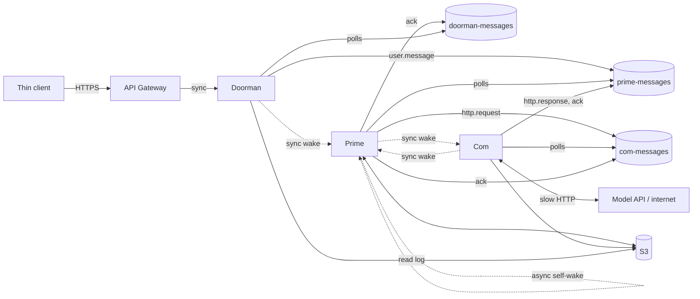

# stz-agent: Spec (draft v2)

> Status: **draft** for a ~4-hour, two-person hackathon PoC. Items marked **[TBD]** are open; see [open-questions.md](open-questions.md). The wire protocol (queues, acks, wakes) is in [protocol.md](protocol.md).

## 1. Goal

Show that an AI agent harness can **scale to zero while it waits**. When the agent is blocked on a slow call, such as model inference or a slow fetch from a REPL script, the expensive harness process exits and stops billing. A cheap process holds the open connection and wakes the harness when the result lands.

This is a demo of the architecture, not of agent features. When a choice comes up, pick whatever keeps the scale-to-zero path simple and visible.

### Success criteria (the demo)

1. A user sends a message from a thin client. The agent makes a slow model call (≥ 60 s, using the mock slow model, §8). Prime **exits during the wait**, is **woken** when the response lands, and the turn completes correctly.
2. A REPL script that `await`s a slow `fetch` survives a Prime exit and restart **mid-await**. A function the model defined earlier is still callable after the restart.
3. A cost readout from CloudWatch `REPORT` lines shows Prime's billed GB-seconds against wall-clock time. Idle time should be billed to Com (128 MB), not Prime (2 GB).

### Non-goals

- **Browser**: tabled for the hackathon.
- Multiple concurrent sessions, multi-tenancy, real auth.
- Streaming tokens to the client. Responses land in S3 whole before Prime sees them.
- A tool catalog. The model gets one tool, the REPL, and writes scripts for everything else.
- Crash recovery beyond "redo from the last checkpoint" (protocol §9E).

## 2. Components

All function code is **TypeScript (Node.js)**. Infra stays in Python CDK.

| Name | Memory | Concurrency | Job |
|---|---|---|---|
| **Doorman** | 128 MB | reserved = 1 | API Gateway handler. Hands user messages to Prime (waking it if needed) and serves the log to the client. |
| **Prime** | 2 GB | reserved = 1 | Agent harness: agent loop, append-only log, QuickJS-in-WASM REPL, network proxy. Exits whenever it's idle, including while requests are in flight. |
| **Com** | 128 MB | reserved = 1 | Outbound HTTP for Prime. Holds connections open, streams response bodies to S3, and notifies Prime. |

Prime gets 2 GB as headroom (WASM snapshots, large model contexts). That's more than it needs without the browser, and it also makes the cost contrast with Com obvious.

Supporting resources (one set per stack/env):

- **S3 bucket**: log, request/response bodies, Prime checkpoints, workspace files.
- **SQS**: one message queue per Lambda: `doorman-messages`, `prime-messages`, `com-messages`, plus DLQs. **No wake queues, and no Lambda triggers.** Each running instance polls its own queue.
- **Wakes**: a **sync Lambda invoke** with a 2 s client-side abort. Prime's self-continuation uses an async invoke instead. See protocol §4.
- **API Gateway** (HTTP API) → Doorman.
- **Secrets Manager**: model API keys (Anthropic, OpenAI-compatible), readable **only by Com**.



## 3. Core rules

These are the invariants. Code that breaks one of them is a bug.

1. **Prime makes no outbound network calls of its own** except to AWS (S3, SQS, Lambda). Model calls and REPL fetches all go through Com.
2. **Prime's state lives in its checkpoint** in S3: harness state, REPL snapshot, and workspace. The log is the append-only *record* of all interactions. It feeds the client and the demo, but Prime doesn't restore from it.
3. **Positive handoff.** A sender stays responsible for each message until the recipient acks it. A missing ack → wake → keep waiting (protocol §5).
4. **Bodies go through S3, never through SQS.** Messages carry IDs and S3 keys only.
5. **One live instance per Lambda** (reserved concurrency 1). Single-writer assumptions rely on this.
6. **Prime exits only when the exit checklist (§5.5) passes.** Pending Com requests never block exit.

## 4. Session model and storage

There is **one agent per stack** with **one log**. `/clear` starts a new *conversation*: the model context resets, but the **REPL state and workspace carry over**, because the scripts the model has built up are the valuable part.

```
s3://<bucket>/
  log/<seq:010d>.json                # append-only record, one object per event
  bodies/<request_id>.req            # HTTP request body (written by Prime)
  bodies/<request_id>.res            # HTTP response body (written by Com)
  prime/ckpt-<n>/state.json          # harness state (§5.4)
  prime/ckpt-<n>/repl.bin            # QuickJS WASM snapshot
  prime/latest.json                  # {"n": N}. Written LAST, so a checkpoint is atomic
  workspace/...                      # REPL file system, mirrored from /tmp/workspace
```

### 4.1 Log

- Prime is the **only writer**. Each event is written with S3 `If-None-Match: *`, so an existing seq is never overwritten. On a conflict, take the next free seq and log a `lifecycle: seq_conflict` event (this happens after a crash, §5.4). Writes are not ordered by anything else.
- Event shape:

```json
{
  "seq": 42,
  "ts": "2026-11-19T20:01:02.345Z",
  "run": "…",                // Lambda request id of the Prime run that wrote it
  "conv": 3,                 // conversation number; increments on /clear
  "kind": "user.message | conv.clear | model.request | model.response | tool.call | tool.result | http.request | http.response | lifecycle | error",
  "corr_id": "…",            // request_id / tool_call_id, links pairs
  "msg_id": "…",             // inbound msg_id, if any
  "body": { },               // small inline payload
  "body_ref": "bodies/…"     // or a pointer to a large payload
}
```

- `lifecycle` events (`start`, `restore`, `stale_wake`, `checkpoint`, `exit_idle`, `exit_deadline`, `wake_sent`) drive the demo narrative and the cost report.

## 5. Prime

### 5.1 Handler flow

1. **Init (module scope).** Load the harness code and **compile the QuickJS WASM module here**. Init runs only on a Lambda cold start, so this work is paid once per execution environment and reused by every warm invocation.
2. **Start the comms worker first** (protocol §6). It starts polling `prime-messages` and acking immediately. Senders get their ack after init alone, without waiting for the restore.
3. **Stale-wake check.** If no non-ack message arrives within about 1 s and the invocation isn't `reason: "continue"`, log `stale_wake`, stop the worker, and return without restoring. A `prewake` takes this path on purpose: its only job is to get the cold start out of the way (§7).
4. **Restore** the latest checkpoint (§5.4) and sync the workspace to `/tmp/workspace`.
5. **Drain and run.** Process messages handed over by the worker. Run the agent loop while there is runnable work:
   - A `user.message`, or a `model.response` with tool calls, is runnable. So is a REPL eval that settled after a response came in.
   - Model call: build the request with the model adapter, write the body to S3, log `model.request`, send `http.request` via the worker, and **don't wait**.
   - `repl` tool call: see §5.2.
   - `/clear`: log `conv.clear` and reset the model context in state.
6. **Exit** once the checklist (§5.5) passes. At the 12-minute run deadline, use the continuation path instead (§5.5).

**Warm vs. cold starts.** After a run, Lambda freezes the execution environment and may reuse it for the next invocation. A warm start skips init: the harness is loaded and the WASM is compiled.
- AWS doesn't specify how long an idle environment is kept. It's commonly observed at minutes to tens of minutes, and it isn't guaranteed. An environment can also be recycled at any time, and a code deploy discards it. **[TBD: measure during the hackathon.]**
- **Don't rely on in-memory session state carrying over**: always restore from the checkpoint.
- Optional optimization: skip the restore when memory already holds checkpoint `n == latest`.

### 5.2 REPL (QuickJS in WASM)

- **One tool**: `repl(code) → {value, stdout, stderr, error}`. The model writes scripts for file I/O, HTTP, and parsing.
- **Runtime**: QuickJS compiled to WASM, running on Prime's **main thread**. SQS traffic is on the comms worker, so a long eval doesn't block acks. REPL state lives in WASM linear memory, and a snapshot of that memory (plus mutable globals and table) is the REPL's persisted state. **[RISK: spike S1.]**
- **Never use an Asyncify build.** All host↔REPL async goes through JS promises, so the WASM call stack is always empty between host calls. That's what makes snapshots consistent.
- **No host-side handles across a checkpoint.** Any state the host needs to find again lives in JS globals inside the snapshot:
  - `globalThis.__pending[request_id]` holds `{resolve, reject}` for in-flight fetches.
  - `globalThis.__evals[tool_call_id]` holds `{status, value, error}` for evals that haven't settled.
  - The host *reads* these after running pending jobs.
- **Host functions** (`__host_fetch`, `__host_log`, fs bindings) must be registered **in the same order on every boot**, so references inside the snapshot stay valid. **[RISK: verify in spike S1.]**
- **Eval**: each eval is wrapped as `__evals[id] = {status:"pending"}; (async () => { <code> })().then(...)`, which writes its result into `__evals[id]`. The host then runs pending jobs to quiescence.
  - If the eval settles, log `tool.result` and continue the turn.
  - If it is still pending, it can only be waiting on `__pending` fetches, because no timers exist. The tool call stays open and the model turn waits. **This is the scale-to-zero case.**
- **Eval CPU time limit** is 30 s **[TBD]**, enforced with the QuickJS interrupt handler.
- **Timers**: `setTimeout`/`setInterval` are **not provided** in v0, because a pending timer would block exit.
- **File I/O**: `/workspace` maps to `/tmp/workspace`, which is synced to S3 `workspace/` at checkpoint.

### 5.3 Network proxy and model adapters

- The REPL has no sockets. `fetch(url, opts)` inside the REPL calls `__host_fetch`, which is Prime's proxy handler:
  1. It assigns a `request_id`, stores the resolver in `__pending`, records the request in `state.pending_requests`, writes the request body to S3, logs `http.request`, and sends the request to Com via the comms worker.
  2. It returns immediately. The REPL sees a pending promise.
  3. When `http.response` arrives, possibly in a later Prime run, the proxy reads the body from S3, calls `__pending[id].resolve(...)` (or `reject`) inside the REPL, and runs pending jobs.
- The harness's model calls use the same path to Com, so Com has a single code path.
- Each request names an `auth` mode for Com: `none` (always used for REPL fetches), `anthropic`, `openai`, `bedrock`, or `mock`.
- **Model adapters** in Prime translate the harness's internal turn format to and from each provider's wire format:
  - the Anthropic Messages API;
  - the **OpenAI Chat Completions spec**: any OpenAI-compatible endpoint, configured by base URL + model name (e.g. OpenAI, vLLM, Ollama, OpenRouter);
  - Bedrock.

  The provider is chosen by config (env var), not per turn. The mock model speaks the Anthropic format; if time allows, add an OpenAI-shaped mock too.

### 5.4 Checkpoint and restore

A **checkpoint** consists of:
- `state.json` (below);
- `repl.bin` (the WASM snapshot);
- a sync of `/tmp/workspace` to `workspace/`.

They are written in that order, and **then** `prime/latest.json` is updated to point to `n`. A crash in the middle leaves the previous checkpoint in effect.

`state.json` holds everything else Prime needs to resume:

```json
{
  "n": 17,
  "conv": 3,
  "model_context": [ ... ],                 // messages for the current conversation
  "pending_requests": {                     // in flight at Com, awaiting http.response
    "<request_id>": {"purpose": "model|repl", "tool_call_id": "…", "sent_at": "…", "timeout_s": 600}
  },
  "open_tool_calls": ["<tool_call_id>"],    // evals still pending in the REPL
  "seen_msg_ids": ["…"],                    // recent inbound msg_ids, for dedupe (bounded, e.g. last 1000)
  "next_seq": 312
}
```

When to checkpoint:
- at exit;
- at the 12-minute continuation.

**[TBD: also after each completed turn, if checkpoint cost is low.]**

**Inbound messages are deleted from SQS only after a checkpoint that includes their effects is durable** (protocol §6). This is what makes the checkpoint and the queue consistent:
- **On a clean run**, every message processed in the run is deleted right after the final checkpoint.
- **On a crash**, the undeleted messages reappear after the visibility timeout. The next Prime restores the last checkpoint and processes them again.
  - Work from the lost run is redone. Side effects may repeat: REPL file writes, duplicate requests to Com.
  - Responses for `request_id`s not in `pending_requests` are logged and dropped.
  - The log keeps the lost run's events, tagged with its `run`.

**Stale pending requests.** On restore, any `pending_requests` entry older than `timeout_s` + 60 s is failed as `lost`: Com died and its requests died with it. Its REPL promise is rejected, or a model call is reported as failed, and the turn carries on.

### 5.5 When Prime may exit (exit checklist)

Prime returns from its handler only when **all** of these hold, checked in this order:

1. **Harness idle.** There's no unprocessed `model.response`, and no `user.message` waiting for a model call. **Pending Com requests are fine. Waiting on them is the reason to exit.**
2. **REPL quiescent.** No eval is executing, and the QuickJS job queue has been drained to empty. Every open eval is waiting only on `__pending` fetches.
3. **Outbound acked.** The comms worker's unacked set is empty: Com has acked every `http.request`. Until it acks, Com may never see the request.
4. **Checkpoint durable** (§5.4).
5. **Held messages deleted.** Every message processed in this run has been deleted from SQS.
6. **Final poll empty.** A final message-queue poll of `IDLE_GRACE` (2 s **[TBD]**) returns nothing. If a message arrives, process it and go back to step 1.

**Continuation at 12 minutes.** At 12 min of run time, Prime stops starting new work, finishes the current eval (bounded by the eval limit), and runs steps 2–5. It then sends the **async self-wake** `{reason: "continue"}` as its very last action and returns (protocol §4.2).

**No linger.** Prime can't know how long a wait will be, so v0 always exits as soon as the checklist passes. A fuller build could learn expected durations from logged request timings and stay up for short ones. That's out of scope.

## 6. Com

- One instance with many concurrent requests (Node async I/O). It uses the same comms worker module as Prime.
- On `http.request`:
  - Check the deadline rule first (protocol §8). If the request doesn't fit in the remaining run time, leave it **unacked** in the queue.
  - Otherwise: ack it, delete it, read the body from S3, register it as in-flight, and start the request.
- Auth modes:
  - `anthropic` attaches `x-api-key` from Secrets Manager.
  - `openai` attaches `Authorization: Bearer <key>` from Secrets Manager, with one key per configured base URL.
  - `bedrock` signs the request with SigV4 using Com's role.
  - `mock` uses the mock model (§8).
  - `none` sends the request unchanged.
- Com is provider-agnostic apart from auth. It doesn't parse model responses; it just stores bytes.
- Stream the response body to `bodies/<request_id>.res` (S3 multipart or `lib-storage` `Upload`). Never buffer the whole body in memory.
- When the request finishes or fails, send a terminal `http.response` to Prime: success, HTTP error, or timeout. The delivery monitor handles the ack and any wakes.
- Per-request default timeout: 10 min **[TBD: shorter, so Com's accept window is wider?]**
- **Exit** when nothing is in flight, the unacked set is empty, and a final poll is empty (protocol §7.2).
- **If Com dies, its in-flight requests die with it.** Prime fails them on restore (§5.4).

## 7. Doorman and API

| Method | Path | Behaviour |
|---|---|---|
| `POST` | `/messages` | Body `{msg_id, text}`, where the **client generates `msg_id`**. Text `/clear` is a clear. Doorman sends `user.message` to `prime-messages` and runs the delivery monitor for up to ~20 s. Returns `202` on ack, or `503` if no ack arrived; the client then retries with the same `msg_id`. |
| `POST` | `/wake` | **Pre-wake.** Doorman sync-wakes Prime with `{reason: "prewake"}` and returns `202` immediately. It sends no message and waits for no ack. The client calls this when the user opens it. Prime pays its **Lambda cold start** (init + WASM compile), takes the stale-wake path, and exits in about 1 s. The environment then stays warm, so the user's real messages get warm starts. |
| `GET` | `/events?after=<seq>` | Lists and reads `log/` objects after `seq`. **Never wakes Prime.** |

- Doorman is single-instance with its own ack queue (`doorman-messages`), which makes it symmetric with Prime and Com. It deletes every message it reads, including stale acks from earlier requests.
- **Doorman only blocks while it waits for Prime's ack.** If Prime is awake, that's under a second. If Prime is asleep, it's one wake plus Prime's cold init. It is *not* the restore, because Prime acks before restoring.
- **The demo client is sequential.** It never issues a `GET` while a `POST` is outstanding, so a single-instance Doorman doesn't throttle it. After a `202`, it polls `GET /events` every 1–2 s until the turn ends. A concurrent client is possible later; see open-questions for the reader-Lambda option.
- Auth: a static bearer token in an environment variable.
- Client: a small TS CLI REPL (`client/`).

## 8. Demo and test tooling

- **Mock model** (`auth: "mock"`): Com sleeps N seconds and returns a canned Messages-API-shaped response. Its responses come from a configurable script, e.g. a tool call that runs a `fetch`, then a final answer. This gives deterministic, cost-free runs of the full loop.
- **Slow URL for REPL fetches**: Com handles `mock://slow?seconds=90&body=...` the same way.
- **Cost report**: `scripts/cost-report.ts` pulls `REPORT` lines for all three functions over a time window. It compares their billed GB-s with what Prime alone would cost if it stayed up for the whole wall-clock time.
- **Tests**:
  - CDK assertions: queues, visibility timeouts, reserved concurrency, no event source mappings, Com-only secret access, Prime's event-invoke config.
  - Unit tests: run the delivery monitor and the comms worker against an in-memory queue and a fake invoke that returns 429/started/failed. Cover the walkthroughs in protocol §9.

## 9. Repo layout

```
app.py, stz_agent/           # CDK (Python). Functions built with esbuild → lambda.Code.from_asset
                             #   (or aws_lambda_nodejs.NodejsFunction)
functions/                   # one TS package (npm workspace)
  shared/envelope.ts         # message types
  shared/comms-worker.ts     # poller, acks, unacked sets, delivery monitor, sync wake
  doorman/  prime/  com/
client/                      # TS CLI
scripts/cost-report.ts
docs/
```

## 10. Hackathon plan (~4 h, two people)

Spikes to run first:

- **S1 (Track B): QuickJS WASM snapshot/restore.**
  - Restore variables and functions into a fresh instance in a new process.
  - Resolve a pending promise after restore.
  - Confirm host functions still work when re-registered in the same order.
  - Measure snapshot size and restore time.
- **S2 (Track A): Lambda wake behaviour.**
  - Does a sync invoke to a busy target return 429 with reason `ReservedFunctionConcurrentInvocationLimitExceeded`?
  - After a client-side abort at 2 s, does the target keep running? Use a test function that writes an S3 marker after 10 s.
  - Does an async self-wake run within seconds of the instance exiting?

| Time | Track A | Track B |
|---|---|---|
| 0:00–0:20 | Agree `envelope.ts`, the S3 layout, and `state.json` together | |
| 0:20–1:30 | CDK: bucket, queues, 3 functions (stubs), API GW. **Spike S2** using the stubs | **Spike S1**: plain Node first, then in Lambda |
| 1:30–2:30 | `comms-worker.ts` + Com (HTTP, S3 streaming, mock) + Doorman | Prime: log, agent loop against the mock model, REPL tool, proxy |
| 2:30–3:15 | Integrate: Doorman → Prime → Com → Prime | Checkpoint/restore + the exit checklist |
| 3:15–4:00 | Client + cost report | Demo run with a real model + slow fetch |

**Fallback if S1 fails by about 1:30**: restore by **replaying** every logged eval in order into a fresh QuickJS, serving each `fetch` from logged responses instead of calling Com again. It's slower and assumes evals are deterministic apart from `fetch`, but the demo still works.
